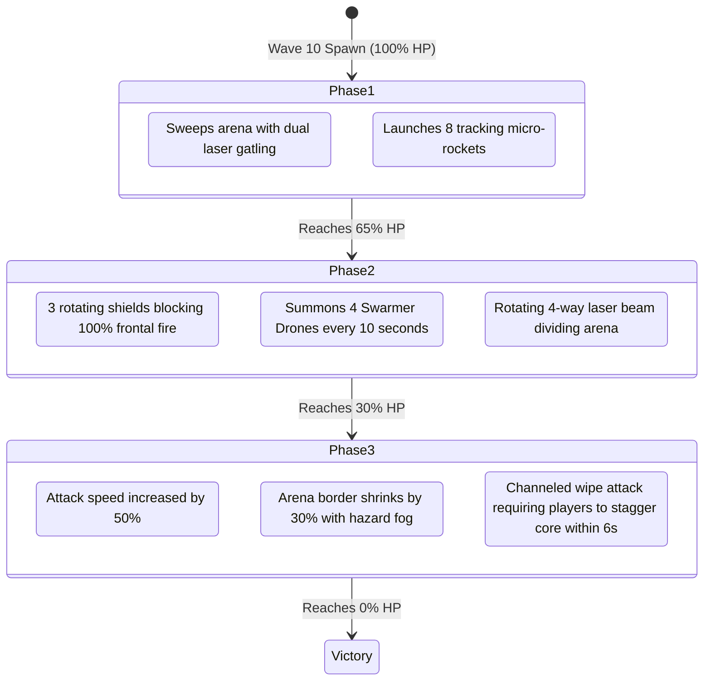

# GAME DESIGN DOCUMENT (GDD)
## Project: Aetheria: Overdrive
**Document Version**: 1.0.0  
**Classification**: Production Specification  
**Lead Designer**: Nguyễn Quý Dương (`Blackerd`)

---

## 1. Executive Summary & High Concept

### 1.1 One-Sentence Pitch
**Aetheria: Overdrive** is a fast-paced, top-down isometric co-op roguelite arena game where 1 to 4 cybernetically enhanced operatives battle relentless alien-mechanical swarms, synergetically drafting game-altering perks to overload the Aetheria Core before the facility suffers catastrophic collapse.

### 1.2 Target Audience & Platforms
- **Primary Platform**: Unity WebGL (instant in-browser play, 0 installation) embedded directly in developer portfolio.
- **Secondary Platform**: Windows PC Standalone (`.exe` binary) with high-fidelity effects and unlocked framerate.
- **Audience**: Fans of *Enter the Gungeon*, *Soul Knight*, *Risk of Rain 2*, and *Brawl Stars*.
- **Game Engine**: Unity 6 / Unity 2022 LTS (C#).

### 1.3 Core Pillars
1. **Kinetic, High-Response Combat**: Instantaneous input response, impactful hit feedback (damage numbers, screen shake, hit freeze frames), and skill-based invulnerability dash.
2. **True Co-op Synergy**: Abilities designed to combo across classes (e.g., Vanguard clusters enemies with Gravity Well, Shadowblade triggers AoE execute, Lumina boosts attack speed).
3. **High Replayability Roguelite Draft**: Every wave transition presents a 3-card perk draft offering transformative build variety across each run.

---

## 2. Worldbuilding & Narrative Premise

### 2.1 The Lore: Aetheria Core Facility
Deep within the sub-oceanic research fortress *Aetheria Station 09*, humanity attempted to tap into dark antimatter energy known as **The Void Flux**. An unexpected dimensional fracture destabilized the reactor core, transforming automated security sentries into corrupted bio-mechanical horrors.

### 2.2 The Overdrive Protocol
With the automated emergency bulkheads sealed, the station AI activates the **Overdrive Protocol**: deploying an elite fireteam of augmented operatives into the reactor chamber. Their objective: survive 10 consecutive quarantine waves, defeat the rogue AI warden **Apex Overlord**, and manually trigger the core stabilizer.

---

## 3. Core Gameplay Loops

### 3.1 Micro Loop (Second-to-Second: 5 – 10 seconds)
```
Read Threat Trajectory ──► Position & Aim ──► Shoot / Use Skill ──► Dash Through Hazard ──► Collect Aether Shards
```
- Operatives continuously evaluate bullet patterns, utilize dash invulnerability frames (0.2s), and eliminate priority targets.

### 3.2 Meso Loop (Minute-to-Minute: 2 – 3 minutes per wave)
```
Wave Spawns ──► Survive Wave Influx ──► Defeat Wave Commander ──► Clear Arena ──► 3-Card Roguelite Perk Draft
```
- Each wave introduces higher enemy density, new enemy archetypes, and environmental hazards (laser grids, void puddles).

### 3.3 Macro Loop (Run-to-Run: 15 – 20 minutes)
```
Select Class & Loadout ──► Enter Arena (Solo or Party) ──► Battle 10 Waves ──► Defeat Apex Overlord ──► 
Extract with Core Relics ──► Unlock Permanent Meta Talents & Badges ──► Climb Global Leaderboard
```

---

## 4. Playable Operative Classes

Players can select from three distinct operative classes, each fulfilling a vital role in both Solo and Co-op play.

| Attribute | Vanguard (Titan) | Shadowblade (Assasssin) | Lumina (Tech-Medic) |
| :--- | :--- | :--- | :--- |
| **Role** | Frontline Tank / CC | Burst DPS / Mobility | Support / Buffer / Healer |
| **Base HP** | 200 | 110 | 140 |
| **Base Shield** | 100 | 50 | 80 |
| **Move Speed** | 5.5 m/s | 7.2 m/s | 6.2 m/s |
| **Primary Weapon** | Heavy Scatter-Shotgun | Dual Cyber-Blades & Shuriken | Plasma Beam Rifle |
| **Active Skill (Q)** | **Gravity Vortex**: Pulls all nearby enemies into a singularity for 2s. | **Shadow Blink**: Teleports 8 meters forward, slashing all targets in path. | **Nanite Healing Field**: Deploys a 5m aura restoring 15 HP/s to allies for 6s. |
| **Ultimate Ability (R)** | **Aegis Fortress**: Grants entire team invulnerable shield + 50% damage reflection for 4s. | **Blade Storm**: Unleashes 360-degree flurry of 24 homing energy daggers. | **Overcharge Matrix**: Overclocks team weapons (+40% Fire Rate, +30% Crit Chance) for 8s. |
| **Passive Trait** | **Kinetic Plating**: Taking damage releases an electric shockwave (20 DMG, 3s CD). | **Executioner**: Deals +35% bonus damage to enemies below 30% HP. | **Field Doctor**: Revives downed teammates in 1.5s instead of standard 4.0s. |

---

## 5. Combat System & Mathematical Mechanics

### 5.1 Primary Stats Formula
$$\text{Damage Dealt} = (\text{Base Weapon Damage} \times \text{Weapon Multiplier}) \times (1 + \text{Damage Buffs}) \times \text{Crit Multiplier}$$

- **Base Critical Strike**: 5% base chance, deals 150% damage.
- **Armor Damage Mitigation**:
$$\text{Damage Taken} = \text{Raw Damage} \times \frac{100}{100 + \text{Armor}}$$

### 5.2 Shield & Health Flow
1. Damage is first absorbed by **Energy Shield**.
2. When Shield reaches 0, excess damage penetrates to **Health**.
3. Shields regenerate after **3.0 seconds** of not taking damage at a rate of **25 Shield/sec**.
4. Health does not regenerate automatically (requires Lumina nanites or health drop pickups).

### 5.3 Invulnerability Dash
- **Cooldown**: 1.8 seconds.
- **Duration**: 0.35 seconds.
- **Invulnerability Window**: 0.20 seconds during the middle of the dash.
- Operatives can pass through non-solid projectiles and small enemies while dashing.

---

## 6. Enemy Bestiary & Boss Design

### 6.1 Regular Enemies
| Enemy Name | Type | Speed | HP | Attack Pattern | Threat Level |
| :--- | :--- | :--- | :--- | :--- | :--- |
| **Swarmer Drone** | Melee | 6.8 m/s | 40 | Rushes operative in swarms of 5-10; explodes on contact (25 AoE DMG). | Low |
| **Void Vanguard** | Tank | 3.5 m/s | 280 | Wields directional energy shield; charges forward knocking players back. | Medium |
| **Phantom Sniper** | Ranged | 4.0 m/s | 80 | Targets operative with visible red laser beam; fires high-velocity piercing beam after 1.5s delay (65 DMG). | High |
| **Pylon Spitter** | Artillery | 0 m/s (Static) | 180 | Fires lobbed mortar shells that leave burning ground hazards for 5s. | High |

### 6.2 The Boss: Apex Overlord (Encountered on Wave 10)
A gargantuan corrupted station security chassis equipped with dual particle cannons and void orbital shields.



---

## 7. Roguelite In-Run Perk Draft (Card System)

At the conclusion of each cleared wave, all operatives enter the **Draft Chamber** and select 1 of 3 randomly drawn cards to mutate their combat capabilities:

### Sample Perk Draft Cards:
1. **Overclock Capacitor (Common)**: +15% Weapon Fire Rate, +10% Bullet Velocity.
2. **Nanite Leech (Uncommon)**: Defeating an enemy restores 4 HP and 8 Shield.
3. **Bouncing Plasma (Rare)**: Projectiles ricochet to 2 additional nearby targets dealing 60% damage.
4. **Void Convergence (Epic)**: Your Dash leaves an imploding black hole that damages and clusters foes.
5. **Aether Overcharge (Legendary)**: Ultimate ability cooldown reduced by 40%; casting Ultimate grants entire team 100% Critical Chance for 5 seconds.

---

## 8. Co-op Mechanics & Downed State

- **Tether Distance**: In 2-4 player games, operatives share a single tactical screen boundary. Moving too far teleports the trailing player forward with a brief shield penalty.
- **Downed Operative State**:
  - When an operative reaches 0 HP, they do not die immediately; they enter **Downed Stasis**.
  - Downed operatives can slowly crawl (1.5 m/s) and fire a weak emergency sidearm.
  - A living teammate must stand inside the revive ring for **4.0 seconds** (1.5s for Lumina) to resurrect them at 50% HP.
  - If all active operatives enter Downed Stasis simultaneously, the mission ends in **Wipe / Defeat**.
