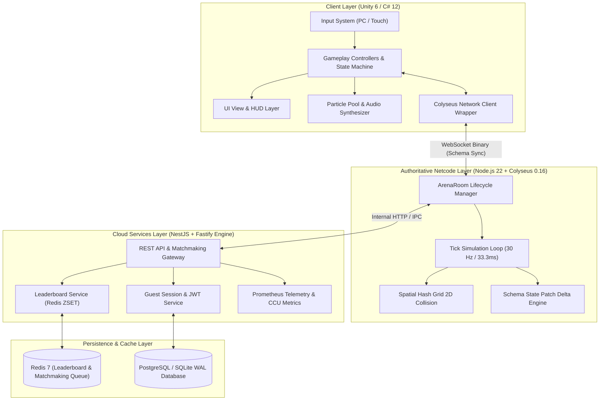

# TECHNICAL DESIGN DOCUMENT (TDD)
## Project: Aetheria: Overdrive
**Document Version**: 1.0.0  
**Classification**: Engineering & System Specification  
**Lead Architect**: Nguyễn Quý Dương (`Blackerd`)

---

## 1. System Topology & Decoupled Architecture

**Aetheria: Overdrive** follows a decoupled 3-tier architecture separating the **Rendering Client**, the **Authoritative Game Simulation Server**, and the **Stateful Cloud Services**:



---

## 2. Unity C# Client Architecture

### 2.1 Design Patterns & Architectural Paradigms
The Unity client is engineered with strict separation of concerns to avoid monolithic `MonoBehaviour` god-classes:

1. **Model-View-Presenter (MVP)**: UI Views contain zero gameplay logic; Presenters subscribe to game events and update views accordingly.
2. **Service Locator**: Global subsystems (Audio, Network, Asset Loader, Input) are registered and resolved through a centralized `ServiceLocator` container.
3. **UniTask (Asynchronous Workflow)**: Complete avoidance of legacy Unity Coroutines in favor of allocation-free `UniTask` (`CancellationToken`-aware).
4. **ScriptableObject Event Channels**: Decoupled publisher-subscriber architecture allowing independent game modules to communicate without direct references.
5. **High-Performance Object Pooling**: Pre-warmed circular pools for projectiles, damage numbers, and particle effects.

### 2.2 Client Folder Structure (Unity Project)
```
Assets/
├── _Scripts/
│   ├── Core/
│   │   ├── ServiceLocator.cs
│   │   ├── GameManager.cs
│   │   └── ObjectPool/
│   │       ├── PoolManager.cs
│   │       └── IPoolable.cs
│   ├── Gameplay/
│   │   ├── Characters/
│   │   │   ├── CharacterBase.cs
│   │   │   ├── OperativeController.cs
│   │   │   ├── OperativeClassData.cs (ScriptableObject)
│   │   │   └── AbilitySystem/
│   │   ├── Combat/
│   │   │   ├── ProjectileBase.cs
│   │   │   ├── DamageInfo.cs
│   │   │   └── Hitbox2D.cs
│   │   ├── Enemies/
│   │   │   ├── EnemyController.cs
│   │   │   └── Boss/ApexOverlord.cs
│   │   └── WaveSystem/
│   ├── Netcode/
│   │   ├── NetworkManager.cs
│   │   ├── ColyseusClientWrapper.cs
│   │   └── Interpolator.cs
│   └── UI/
│       ├── HUD/
│       │   ├── BattleHUDPresenter.cs
│       │   ├── HealthShieldBarView.cs
│       │   └── TeammateStatusCardView.cs
│       └── Draft/
│           └── PerkDraftCardPresenter.cs
├── Prefabs/
├── Settings/
└── StreamingAssets/
```

### 2.3 Object Pooling Performance Specification
To maintain 60 FPS on lower-tier laptops and mobile browsers via WebGL, zero dynamic heap allocations occur during combat:

```csharp
// High-Performance Zero-Allocation Object Pool Interface
public interface IPoolable {
    void OnSpawnFromPool();
    void OnReturnToPool();
}

public class FastObjectPool<T> where T : Component, IPoolable {
    private readonly Queue<T> _pool = new();
    private readonly T _prefab;
    private readonly Transform _parent;

    public FastObjectPool(T prefab, int initialCapacity, Transform parent = null) {
        _prefab = prefab;
        _parent = parent;
        for (int i = 0; i < initialCapacity; i++) {
            T obj = Object.Instantiate(_prefab, _parent);
            obj.gameObject.SetActive(false);
            _pool.Enqueue(obj);
        }
    }

    public T Rent(Vector3 position, Quaternion rotation) {
        T obj = _pool.Count > 0 ? _pool.Dequeue() : Object.Instantiate(_prefab, _parent);
        Transform t = obj.transform;
        t.position = position;
        t.rotation = rotation;
        obj.gameObject.SetActive(true);
        obj.OnSpawnFromPool();
        return obj;
    }

    public void Return(T obj) {
        obj.OnReturnToPool();
        obj.gameObject.SetActive(false);
        _pool.Enqueue(obj);
    }
}
```

---

## 3. Authoritative Netcode Server (Colyseus)

### 3.1 The 30 Hz Fixed Simulation Loop
The server runs a deterministic fixed tick rate at **30 Hz (33.33ms per tick)**:

```
[ Tick 101 Start ] 
  ├── 1. Process Received Input Packets (WASD, Aim Angle, Ability Triggers)
  ├── 2. Update Operative Positions (Verify Speed Limits & Obstacle Collisions)
  ├── 3. Advance Projectiles (Raycast & Circle Casts)
  ├── 4. Advance Enemy AI Paths (Spatial Hash Grid Clustering)
  ├── 5. Evaluate Hit Registrations & Apply Shield/Health Decrements
  ├── 6. Check Wave Clearance & Draft Trigger Conditions
  └── 7. Dispatch Colyseus Binary Schema State Patch to Connected Clients
[ Tick 101 End ]
```

### 3.2 Anti-Cheat & Server Authority Rules
To prevent common web/memory hacking:
1. **Move Speed Validation**: Operative displacement between ticks cannot exceed `MaxSpeed * DeltaTime * 1.15` (15% grace threshold for packet jitter). Flagged packets are snapped back to authoritative position.
2. **Server-Side Projectile Spawning**: Client sends `C2S_FireWeapon { aimAngle, weaponId }`. The server validates cooldowns, spawns the authoritative bullet entity, and broadcasts the bullet UID.
3. **Health & Shield Authority**: Clients never calculate damage taken. The server receives hit registrations, applies armor mitigation, and mutates health state.

---

## 4. Cloud Services & API (NestJS + Fastify)

### 4.1 REST API Endpoints Specification
The cloud services engine operates on port `48000` (or reverse-proxied over HTTPS):

| Method | Endpoint | Description | Auth Required |
| :--- | :--- | :--- | :--- |
| `POST` | `/api/v1/auth/guest` | Generates or resumes a guest player identity. | No |
| `GET` | `/api/v1/leaderboard/global` | Fetches Top 100 players ranked by Wave Cleared & Kill Count. | No |
| `POST` | `/api/v1/leaderboard/submit` | Submits match scorecard signed by Colyseus Server Secret. | Server Secret |
| `GET` | `/api/v1/profile/meta-talents` | Retrieves unlocked persistent skill tree talents. | JWT Bearer |
| `POST` | `/api/v1/profile/upgrade-talent` | Spends Core Relics to purchase persistent stat upgrades. | JWT Bearer |

### 4.2 Redis Real-Time Leaderboard Mechanics
Leaderboard rankings are managed with Redis Sorted Sets (`ZSET`) for $O(\log(N))$ time complexity:

```typescript
// Submitting a run score to Redis Sorted Set
const scoreKey = 'leaderboard:global:wave_score';
const compositeScore = waveCleared * 1_000_000 + totalKills * 10 - elapsedSeconds;
await redisClient.zadd(scoreKey, compositeScore, playerId);

// Fetching Top 10 High Scores
const topPlayers = await redisClient.zrevrange(scoreKey, 0, 9, 'WITHSCORES');
```

---

## 5. WebGL Optimization Strategy

Running a high-intensity action game inside browser tabs requires aggressive memory & bundle optimization:

1. **Unity WebGL Build Profile**:
   - **Compression Format**: Brotli (`.br`) with fallback to Gzip.
   - **Code Stripping**: High stripping level enabled (Managed Stripping Level = High).
   - **Initial Memory Size**: 256 MB (avoids browser allocation crashes on mobile).
2. **Texture & Asset Budgets**:
   - Sprite atlases strictly power-of-two (2048x2048 max, compressed with ASTC / DXT5).
   - Audio clips streaming via Web Audio API, compressed to 96kbps OGG Vorbis.
3. **HTML5 Canvas Container**:
   - Responsive full-viewport letterbox scaling matching 16:9 aspect ratio.
   - Focus lock / Pointer lock integration for mouse aiming.
