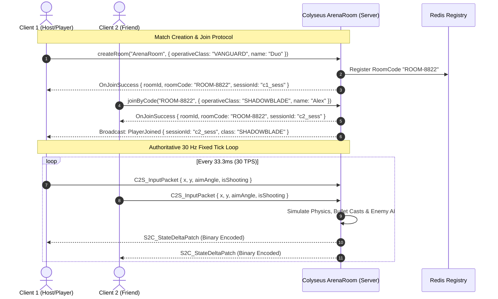

# MULTIPLAYER NETCODE SPECIFICATION
## Project: Aetheria: Overdrive
**Document Version**: 1.0.0  
**Classification**: Protocol & Netcode Specification  
**Lead Netcode Engineer**: Nguyễn Quý Dương (`Blackerd`)

---

## 1. Network Topology & Protocol Architecture

**Aetheria: Overdrive** utilizes a **Dedicated Authoritative Server Architecture** powered by **Colyseus 0.16** running over secure WebSockets (`wss://`). The client acts strictly as a visual and input terminal; the server simulates game physics, hit registrations, and wave timelines.



---

## 2. Colyseus Schema Data Contracts

State synchronization relies on Colyseus's high-efficiency binary delta-packing schema. Only mutated properties are transmitted over the wire.

### 2.1 PlayerState Schema
```typescript
import { Schema, type } from "@colyseus/schema";

export class PlayerState extends Schema {
  @type("string") sessionId: string = "";
  @type("string") name: string = "";
  @type("string") operativeClass: string = "VANGUARD";

  // Position & Kinematics
  @type("number") x: number = 0;
  @type("number") y: number = 0;
  @type("number") aimAngle: number = 0;
  @type("boolean") isDashing: boolean = false;

  // Combat Attributes
  @type("number") health: number = 200;
  @type("number") maxHealth: number = 200;
  @type("number") shield: number = 100;
  @type("number") maxShield: number = 100;
  @type("number") ultimateEnergy: number = 0;

  // State Flags
  @type("boolean") isDowned: boolean = false;
  @type("number") reviveProgress: number = 0.0;
  @type("number") kills: number = 0;
}
```

### 2.2 EnemyState Schema
```typescript
export class EnemyState extends Schema {
  @type("string") id: string = "";
  @type("string") archetype: string = "SWARMER"; // SWARMER, BRUTE, SNIPER, BOSS
  @type("number") x: number = 0;
  @type("number") y: number = 0;
  @type("number") health: number = 40;
  @type("number") maxHealth: number = 40;
  @type("boolean") isStaggered: boolean = false;
}
```

### 2.3 ArenaRoomState (Root Container)
```typescript
import { MapSchema } from "@colyseus/schema";

export class ArenaRoomState extends Schema {
  @type({ map: PlayerState }) players = new MapSchema<PlayerState>();
  @type({ map: EnemyState }) enemies = new MapSchema<EnemyState>();

  @type("string") matchState: string = "LOBBY"; // LOBBY, COMBAT, DRAFT, VICTORY, WIPED
  @type("number") currentWave: number = 1;
  @type("number") waveTimeRemaining: number = 90;
  @type("number") aetherShardsCollected: number = 0;
}
```

---

## 3. Network Message Envelopes (C2S & S2C)

### 3.1 Client-to-Server (C2S) Messages
| Message ID | Payload | Description |
| :--- | :--- | :--- |
| `c2s_input` | `{ x: float, y: float, aimAngle: float }` | Broadcasted by client at 30 Hz. |
| `c2s_fire` | `{ weaponId: string, originX: float, originY: float, angle: float }` | Request to fire weapon projectile. |
| `c2s_dash` | `{ dirX: float, dirY: float }` | Trigger dodge dash with invulnerability. |
| `c2s_skill` | `{ skillSlot: "Q" \| "R" }` | Request to activate class ability or ultimate. |
| `c2s_select_perk` | `{ perkId: string }` | Operative selects chosen roguelite card. |
| `c2s_revive_target` | `{ targetSessionId: string }` | Living player initiates revive channeling on downed ally. |

### 3.2 Server-to-Client (S2C) Event Messages
| Message ID | Payload | Description |
| :--- | :--- | :--- |
| `s2c_bullet_spawn` | `{ id: string, ownerId: string, x, y, vx, vy, isCrit }` | Informs clients to instantiate bullet visual. |
| `s2c_combat_event` | `{ type: "HIT" \| "CRIT" \| "SHIELD_BREAK", x, y, amount }` | Triggers floating damage numbers & sound effects. |
| `s2c_draft_opened` | `{ cards: [ { id, name, rarity, desc } ] }` | Opens 3-card perk selection modal across all players. |
| `s2c_wave_complete` | `{ wave: int, nextWaveDelay: float }` | Wave cleared celebration notification. |
| `s2c_mission_wiped` | `{ totalWaves, totalKills, runDuration }` | All players downed; initiates defeat screen. |

---

## 4. Latency Compensation & Interpolation Buffer

To ensure butter-smooth visual motion on WebGL clients operating across varied network conditions (ping variance 30ms - 150ms):

### 4.1 Client-Side Prediction (Local Player)
- The local player predicts their own movement immediately upon input (`x += input.x * speed * dt`).
- Upon receiving authoritative server state updates, the client applies **Linear Error Reconciliation**:
$$\text{Position Error} = \text{Server Pos} - \text{Client Pos}$$
- If $|\text{Position Error}| > 0.05\text{m}$, the client smoothly snaps the error toward 0 over 3 frames. If $|\text{Position Error}| > 2.0\text{m}$ (teleport or speedhack denial), position snaps instantly.

### 4.2 Snapshot Interpolation (Remote Teammates & Enemies)
- Remote players and enemies are rendered using an **Interpolation Delay Buffer of 100ms** (approximately 3 server ticks).
- The client buffers states $\{S_{t-2}, S_{t-1}, S_t\}$ and interpolates between the two most recent snapshots:
$$\vec{P}_{\text{render}} = \text{Lerp}(\vec{P}_{\text{prev}}, \vec{P}_{\text{curr}}, \alpha), \quad \alpha = \frac{T_{\text{render}} - T_{\text{prev}}}{T_{\text{curr}} - T_{\text{prev}}}$$

---

## 5. Reconnection & Session Recovery

- **Transient Disconnect Window**: If a player's WebSocket drops (e.g., mobile tab switch, WiFi flicker), the server holds the `PlayerState` in **DORMANT** status for **60 seconds**.
- **Reconnection Token**: On initial join, the client stores a cryptographic `reconnectionToken`. Upon reconnecting, calling `client.reconnect(roomId, reconnectionToken)` immediately restores operative state, inventory, and current perks without interrupting teammates.
