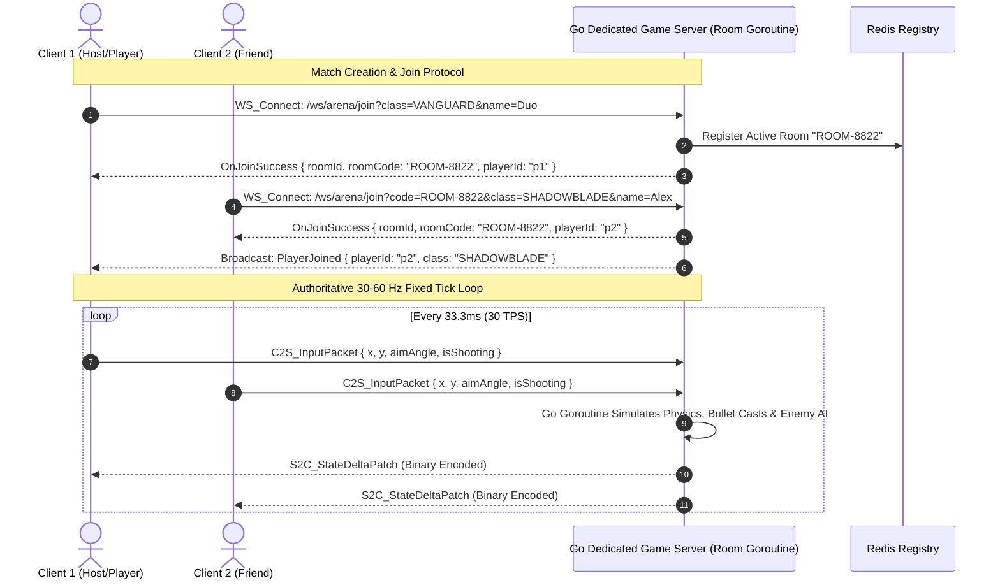

# MULTIPLAYER NETCODE SPECIFICATION
## Project: Aetheria: Overdrive
**Document Version**: 2.0.0 (Go WebSocket Binary Engine)  
**Classification**: Protocol & Netcode Specification  
**Lead Netcode Engineer**: Nguyễn Quý Dương (`Blackerd`)

---

## 1. Network Topology & Protocol Architecture

**Aetheria: Overdrive** utilizes a **High-Performance Dedicated Authoritative Game Server** engineered in **Go (Golang 1.23)** operating over low-overhead WebSockets (`wss://`). The client acts strictly as a visual and input terminal; the Go server simulates game physics, hit registrations, and wave timelines.



---

## 2. Server State Data Contracts (Go Structs)

State synchronization relies on compact binary delta-serialization in Go:

### 2.1 PlayerState Definition (Go)
```go
package protocol

type PlayerState struct {
    ID              string  `json:"id"`
    Name            string  `json:"name"`
    OperativeClass  string  `json:"class"` // VANGUARD, BLADE, LUMINA

    // Kinematics
    X               float32 `json:"x"`
    Y               float32 `json:"y"`
    AimAngle        float32 `json:"angle"`
    IsDashing       bool    `json:"dashing"`

    // Combat Stats
    Health          int32   `json:"hp"`
    MaxHealth       int32   `json:"max_hp"`
    Shield          int32   `json:"shield"`
    MaxShield       int32   `json:"max_shield"`
    UltimateEnergy  float32 `json:"ult"`

    // Co-op State
    IsDowned        bool    `json:"downed"`
    ReviveProgress  float32 `json:"revive_pct"`
    Kills           int32   `json:"kills"`
}
```

### 2.2 EnemyState Definition (Go)
```go
type EnemyState struct {
    ID         string  `json:"id"`
    Archetype  string  `json:"type"` // SWARMER, BRUTE, SNIPER, BOSS
    X          float32 `json:"x"`
    Y          float32 `json:"y"`
    Health     int32   `json:"hp"`
    MaxHealth  int32   `json:"max_hp"`
    Staggered  bool    `json:"staggered"`
}
```

### 2.3 ArenaRoomState Container (Go)
```go
type ArenaRoomState struct {
    RoomID             string                  `json:"room_id"`
    RoomCode           string                  `json:"code"`
    MatchState         string                  `json:"state"` // LOBBY, COMBAT, DRAFT, WIPED, VICTORY
    CurrentWave        int32                   `json:"wave"`
    WaveTimeRemaining  float32                 `json:"time_rem"`
    Players            map[string]*PlayerState `json:"players"`
    Enemies            map[string]*EnemyState  `json:"enemies"`
}
```

---

## 3. Network Message Envelopes (C2S & S2C)

### 3.1 Client-to-Server (C2S) Messages
| Opcode / ID | Payload | Description |
| :--- | :--- | :--- |
| `c2s_input` | `{ x: float, y: float, aimAngle: float }` | Broadcasted by client at 30 Hz. |
| `c2s_fire` | `{ weaponId: string, originX: float, originY: float, angle: float }` | Request to fire weapon projectile. |
| `c2s_dash` | `{ dirX: float, dirY: float }` | Trigger dodge dash with invulnerability. |
| `c2s_skill` | `{ slot: "Q" \| "R" }` | Request to activate class ability or ultimate. |
| `c2s_select_perk` | `{ perkId: string }` | Operative selects chosen roguelite card. |
| `c2s_revive_target`| `{ targetPlayerId: string }` | Living player initiates revive channeling on downed ally. |

### 3.2 Server-to-Client (S2C) Event Messages
| Opcode / ID | Payload | Description |
| :--- | :--- | :--- |
| `s2c_bullet_spawn` | `{ id: string, ownerId: string, x, y, vx, vy, isCrit }` | Informs clients to instantiate bullet visual. |
| `s2c_combat_event` | `{ type: "HIT" \| "CRIT" \| "SHIELD_BREAK", x, y, amount }` | Triggers floating damage numbers & sound effects. |
| `s2c_draft_opened` | `{ cards: [ { id, name, rarity, desc } ] }` | Opens 3-card perk selection modal across all players. |
| `s2c_wave_complete`| `{ wave: int, nextWaveDelay: float }` | Wave cleared celebration notification. |
| `s2c_mission_wiped`| `{ totalWaves, totalKills, runDuration }` | All players downed; initiates defeat screen. |

---

## 4. Latency Compensation & Interpolation Buffer

To ensure butter-smooth visual motion on WebGL clients operating across varied network conditions (ping variance 30ms - 150ms):

### 4.1 Client-Side Prediction (Local Player)
- The local player predicts their own movement immediately upon input (`x += input.x * speed * dt`).
- Upon receiving authoritative server state updates from Go, the client applies **Linear Error Reconciliation**:
$$\text{Position Error} = \text{Server Pos} - \text{Client Pos}$$
- If $|\text{Position Error}| > 0.05\text{m}$, the client smoothly snaps the error toward 0 over 3 frames. If $|\text{Position Error}| > 2.0\text{m}$ (teleport or speedhack denial), position snaps instantly.

### 4.2 Snapshot Interpolation (Remote Teammates & Enemies)
- Remote players and enemies are rendered using an **Interpolation Delay Buffer of 100ms** (approximately 3 server ticks).
- The client buffers states $\{S_{t-2}, S_{t-1}, S_t\}$ and interpolates between the two most recent snapshots:
$$\vec{P}_{\text{render}} = \text{Lerp}(\vec{P}_{\text{prev}}, \vec{P}_{\text{curr}}, \alpha), \quad \alpha = \frac{T_{\text{render}} - T_{\text{prev}}}{T_{\text{curr}} - T_{\text{prev}}}$$

---

## 5. Reconnection & Session Recovery

- **Transient Disconnect Window**: If a player's WebSocket drops (e.g., mobile tab switch, WiFi flicker), the Go room holds the `PlayerState` in **DORMANT** status for **60 seconds**.
- **Reconnection Token**: On initial join, the Go server issues a cryptographic `reconnectionToken`. Upon reconnecting, calling `/ws/arena/reconnect?token=...` immediately restores operative state, inventory, and current perks without interrupting teammates.
