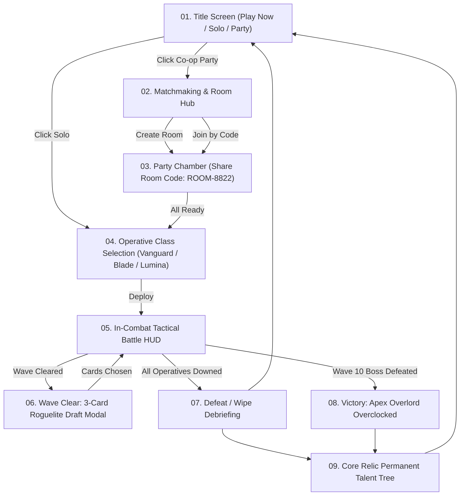

# UI/UX FLOW & WIREFRAMES SPECIFICATION
## Project: Aetheria: Overdrive
**Document Version**: 1.0.0  
**Classification**: Interface Design & User Experience Spec  
**Lead UI/UX Designer**: Nguyễn Quý Dương (`Blackerd`)

---

## 1. Master Screen Flow Architecture

The user journey is structured for near-zero friction. Web players can dive into a battle within 3 clicks:



---

## 2. Screen Wireframes & Component Specs

### 2.1 Screen 01: Title & Mode Selection Screen
Clean, futuristic, high-contrast terminal styling:

```
┌────────────────────────────────────────────────────────────────────────┐
│ [AUDIO ON/OFF]                                           [v1.0.0-PROD] │
│                                                                        │
│                █████╗ ███████╗████████╗██╗  ██╗███████╗                │
│               ██╔══██╗██╔════╝╚══██╔══╝██║  ██║██╔════╝                │
│               ███████║█████╗     ██║   ███████║█████╗                  │
│               ██╔══██║██╔══╝     ██║   ██╔══██║██╔══╝                  │
│               ██║  ██║███████╗   ██║   ██║  ██║███████╗                │
│                                                                        │
│                       --- O V E R D R I V E ---                        │
│               CO-OP ROGUELITE ARENA • FULL-STACK NETCODE               │
│                                                                        │
│                  ┌──────────────────────────────────┐                  │
│                  │  [ ▶ QUICK PLAY (SOLO SURVIVAL) ] │                  │
│                  └──────────────────────────────────┘                  │
│                  ┌──────────────────────────────────┐                  │
│                  │  [ 👥 CO-OP PARTY (2-4 PLAYERS) ] │                  │
│                  └──────────────────────────────────┘                  │
│                  ┌──────────────────────────────────┐                  │
│                  │  [ 🏆 GLOBAL RANKINGS (REDIS) ]   │                  │
│                  └──────────────────────────────────┘                  │
│                                                                        │
│  [◉ OPERATIVE STATUS: ONLINE]                   [CONNECTED: 127 CCU]   │
└────────────────────────────────────────────────────────────────────────┘
```

---

### 2.2 Screen 02: In-Combat Tactical Battle HUD
Designed to maximize battlefield visibility while delivering vital situational awareness:

```
┌────────────────────────────────────────────────────────────────────────┐
│ [WAVE 04/10] ── ⏱️ 01:42 REMAINING                 SCORE: 142,500 ── 🏆  │
│ ────────────────────────────────────────────────────────────────────── │
│                                                                        │
│ ┌─ TEAM STATUS ───────────┐                         ┌─ MINIMAP ──────┐ │
│ │ P1: You (Vanguard)      │                         │  ● Boss Spawn  │ │
│ │ HP [██████████] 180/200 │                         │  ▲ P1   ▲ P2   │ │
│ │ SH [████████░░]  80/100 │                         │  ■ Swarm Wave  │ │
│ │                         │                         └────────────────┘ │
│ │ P2: Alex (Blade)        │                                            │
│ │ HP [██████░░░░] 60/110  │                                            │
│ │ SH [░░░░░░░░░░]  0/50   │                                            │
│ └─────────────────────────┘                                            │
│                                                                        │
│                                 [ARENA VIEW]                           │
│                                                                        │
│                               Operative (You)                          │
│                                      ▲                                 │
│                                                                        │
│ ────────────────────────────────────────────────────────────────────── │
│  HP: [██████████████████░░] 180/200       SHIELD: [████████░░] 80/100  │
│                                                                        │
│  [DASH (SPACE)]     [SKILL (Q): VORTEX]       [ULTIMATE (R): AEGIS]    │
│    READY             ██████░░░░ (3.2s)          [████████████] READY!  │
└────────────────────────────────────────────────────────────────────────┘
```

---

### 2.3 Screen 03: 3-Card Roguelite Perk Draft Modal
Opens simultaneously on all operatives' screens upon wave completion:

```
┌────────────────────────────────────────────────────────────────────────┐
│                   === WAVE 03 CLEARED // CHOOSE PERK ===               │
│                        TIME REMAINING TO PICK: 12s                     │
│                                                                        │
│  ┌───────────────────────┐ ┌───────────────────────┐ ┌───────────────┐ │
│  │   [UNCOMMON PERK]     │ │     [RARE PERK]       │ │ [EPIC PERK]   │ │
│  │                       │ │                       │ │               │ │
│  │   ⚡ OVERCLOCK CORE    │ │   🌀 PLASMA BOUNCE    │ │ 🌌 VOID DASH  │ │
│  │                       │ │                       │ │               │ │
│  │  +20% Attack Speed    │ │  Projectiles bounce   │ │ Dash leaves   │ │
│  │  +15% Bullet Speed    │ │  to 2 extra targets   │ │ an imploding  │ │
│  │                       │ │  dealing 60% DMG.     │ │ singularity.  │ │
│  │                       │ │                       │ │               │ │
│  │      [ SELECT ]       │ │      [ SELECT ]       │ │  [ SELECT ]   │ │
│  └───────────────────────┘ └───────────────────────┘ └───────────────┘ │
│                                                                        │
│  [Teammate Alex chose: PLASMA BOUNCE]                                  │
└────────────────────────────────────────────────────────────────────────┘
```

---

## 3. Cross-Platform Input Mapping Specification

The game seamlessly switches input profiles depending on detected hardware:

| Action | PC Keyboard & Mouse | Mobile / Web Touch | Gamepad (Xbox / PS) |
| :--- | :--- | :--- | :--- |
| **Move Operative** | `W`, `A`, `S`, `D` Keys | Left Virtual Joystick | Left Analog Stick |
| **Aim Direction** | Mouse Cursor Position | Right Virtual Joystick (360°) | Right Analog Stick |
| **Primary Fire** | Left Mouse Button (Hold) | Auto-fire when aiming / Tap | Right Trigger (`RT` / `R2`) |
| **Invulnerability Dash** | `Spacebar` | Dash Action Button | `A` Button / `L1` |
| **Active Class Skill (Q)** | `Q` Key | Skill Button 1 | `LB` / `L2` |
| **Ultimate Ability (R)** | `R` Key | Ultimate Radial Button | `Y` Button / `R1` |
| **Revive Teammate** | `E` Key (Stand in Ring) | Auto-channels in proximity | `X` Button / `Square` |

---

## 4. Visual Feedback & Game Feel (Juice) Matrix

To ensure combat feels punchy, impactful, and responsive:

1. **Hit Stop (Freeze Frame)**: On critical strikes or high-damage blows, animations pause for **30ms (2 frames)** to convey mass and weight.
2. **Screen Shake Dynamics**:
$$\text{Shake Intensity} = \min\left(1.0, \frac{\text{Damage Dealt}}{100}\right) \times \text{Distance Falloff}$$
3. **Damage Number Popups**: Color-coded floating text:
   - **White**: Standard damage.
   - **Gold / Yellow**: Critical strike (150%+ scale with upward bounce).
   - **Cyan**: Shield damage absorption.
   - **Green**: Health restored / healing aura.
4. **Hit Flash**: Enemy sprite flashes pure white (`#FFFFFF`) for 60ms upon registering a bullet collision.
