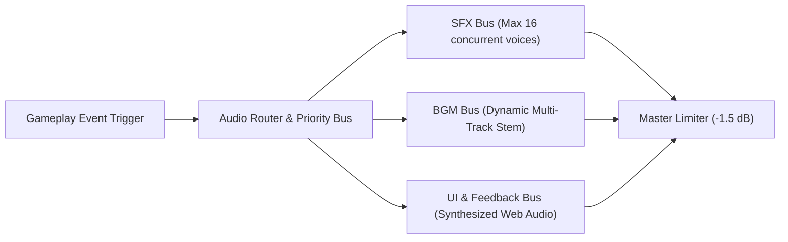

# ART, AUDIO & STYLE GUIDE SPECIFICATION
## Project: Aetheria: Overdrive
**Document Version**: 1.0.0  
**Classification**: Visual & Sound Design Specification  
**Lead Art Director**: Nguyễn Quý Dương (`Blackerd`)

---

## 1. Visual Identity & Art Direction

**Aetheria: Overdrive** embraces a **Neo-Cyberpunk Stylized Sci-Fi** aesthetic: high-contrast dark environments punctuated by intense neon emission channels and clean, readable silhouettes.

### 1.1 Visual Hierarchy & Readability Rules
1. **Background**: Low-contrast, deep indigo-black reactor floors (`#050811`) with subtle hexagonal grid lines and industrial markings.
2. **Interactables & Operatives**: High-contrast, sharp geometric silhouettes with distinctive primary color signatures.
3. **Projectiles & Hazards**: Maximum luminescence and bloom; enemy bullets are tinted hot crimson / orange (`#FF2A55`) to immediately distinguish from friendly cyan / green munitions.

---

## 2. Color Palette & Lighting Tokens

| Token Name | Hex Code | Emission Strength | Usage Application |
| :--- | :--- | :--- | :--- |
| **Aether Cyan** | `#00F5FF` | 2.5 HDR | Vanguard shields, friendly plasma bullets, HUD active accents |
| **Void Magenta** | `#D946EF` | 2.8 HDR | Shadowblade abilities, dimensional rifts, epic perk cards |
| **Reactor Green** | `#22C55E` | 2.0 HDR | Lumina nanites, healing auras, team health bars |
| **Hazard Crimson** | `#EF4444` | 3.0 HDR | Enemy projectiles, boss laser grids, enrage indicators |
| **Overdrive Amber**| `#F59E0B` | 2.2 HDR | Critical hits, gold score drop, legendary perk cards |
| **Deep Chassis** | `#0B1120` | None (Matte) | Arena bulkheads, operative armor plates |
| **Void Abyss** | `#030712` | None (Matte) | Deep background, pit hazards, CRT scanline borders |

---

## 3. Particle VFX Manifest

All particle systems are pre-warmed inside memory object pools using Unity's **VFX Graph / Shuriken Particle System**:

| VFX ID | Trigger Condition | Visual Description | Duration |
| :--- | :--- | :--- | :--- |
| `VFX_MUZZLE_FLASH` | Weapon fired | Sharp directional conical burst of 8 particles with point light flash. | 60ms |
| `VFX_BULLET_TRACER` | Bullet traveling | Ribbon trail renderer fading from bright core to soft emission. | Dynamic |
| `VFX_IMPACT_HIT` | Bullet hits enemy | Directional spark shower + momentary white hit flash. | 150ms |
| `VFX_SHIELD_BREAK` | Shield drops to 0 | Shattering glass hexagonal fragments accompanied by a cyan shockwave. | 400ms |
| `VFX_DASH_TRAIL` | Operative dashes | 4 ghosted motion-blur afterimages fading behind operative trajectory. | 350ms |
| `VFX_VORTEX_SUCK` | Vanguard skill (Q) | Inward spiraling particle vortex pulling ambient dust and enemy meshes. | 2.0s |
| `VFX_CORE_MELTDOWN`| Boss phase 3 | Ambient red fog rising from floor grid with rising embers. | Looping |

---

## 4. Audio Architecture & Sound Design

### 4.1 Audio Engine Pipeline
Audio is managed through a central `SoundManager` utilizing Web Audio API streaming for WebGL and FMOD / Unity AudioSource for standalone:

### 4.2 Sound Effects (SFX) Manifest
| Sound Event ID | Description & Synthesizer Signature | Pitch Variance |
| :--- | :--- | :--- |
| `SFX_SHOT_PLASMA` | High-frequency laser pop with mechanical mechanical bolt click. | $\pm 5\%$ |
| `SFX_SHOT_SHOTGUN` | Deep punchy bass boom layered with metallic shell ejection. | $\pm 3\%$ |
| `SFX_DASH_WHOOSH` | Synthesized air displacement whoosh with sub-bass drop. | None |
| `SFX_HIT_FLESH` | Dampened squelch / impact thud. | $\pm 8\%$ |
| `SFX_HIT_SHIELD` | High-pitched metallic ping / glass resonance. | $\pm 4\%$ |
| `SFX_PERK_SELECT` | Synthesized triumphant metallic chime (C Major Arpeggio). | None |
| `SFX_HEARTBEAT` | Low-pass filtered rhythmic thumping (triggered when HP < 25%). | Tempo tracks HP |

### 4.3 Adaptive Music (BGM)
- **Lobby & Draft**: Atmospheric ambient drone (75 BPM) with subtle synth pads.
- **Combat Waves 1-9**: High-octane synthwave / industrial drum & bass (135 BPM) that intensifies as enemy count increases.
- **Apex Overlord Boss (Wave 10)**: Heavy distorted guitar riffs blended with orchestral choir and relentless electronic kick drums (150 BPM).
